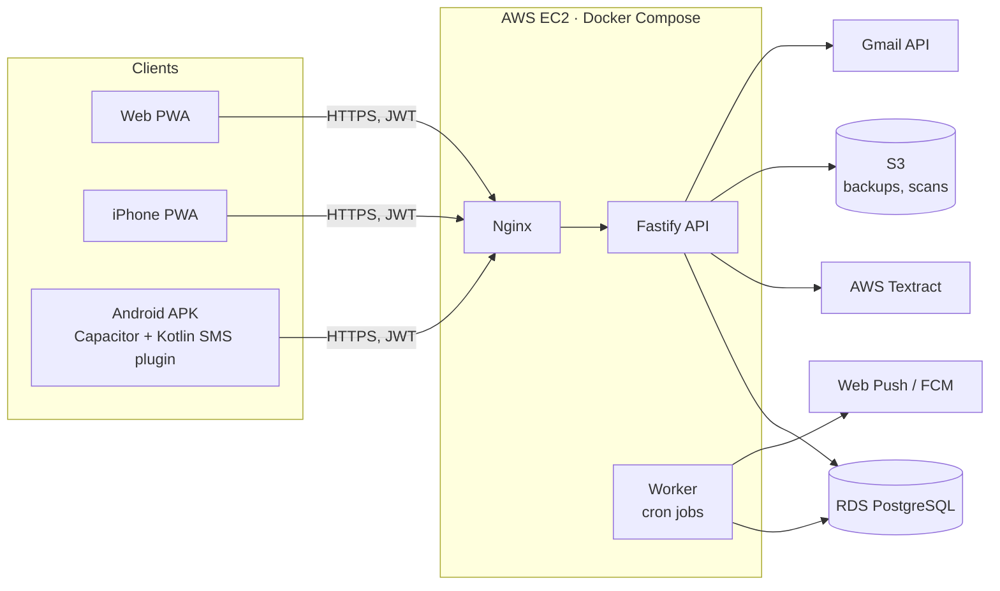
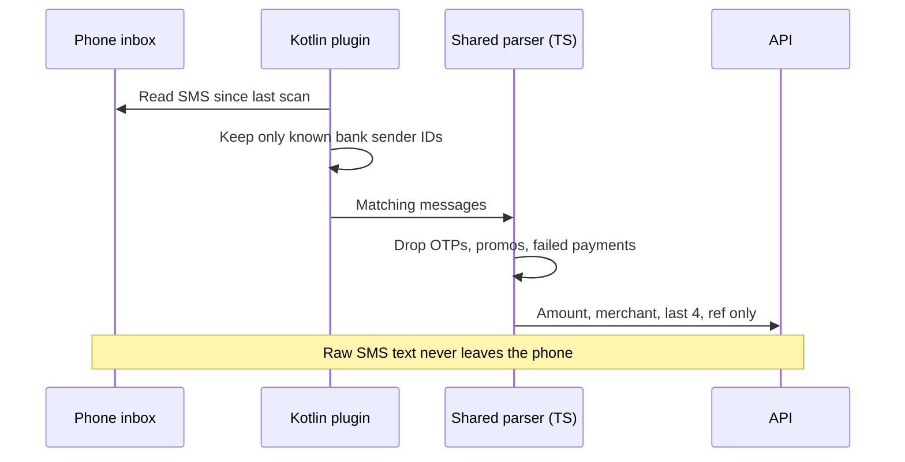

# Money Tracker

A personal finance app for hostel students. Log income and expenses, set budgets and savings goals, and see where the month's money went. On Android it can read bank SMS and fill in your transaction history for you.

Built by **Team G, Microsoft Innovations Club, VIT Chennai**.

## What it does

- Quick income and expense entry, with categories made for hostel life (mess, canteen, laundry, recharge, printouts, travel home)
- Budgets and savings goals, with alerts at 50%, 80% and 100%
- Dashboard with category split, daily trend, "safe to spend today" and runway
- Automatic capture from bank SMS (Android), bank emails and scanned bills
- Works offline and syncs when the connection is back
- Installable PWA with push notifications

## Platforms

| Capability | Web | iPhone (PWA) | Android (APK) |
|---|---|---|---|
| Manual entry, budgets, goals, dashboard | Yes | Yes | Yes |
| SMS capture | No | No | Yes |
| Email capture (Gmail) | Yes | Yes | Yes |
| Bill scan | Upload | Camera or upload | Camera or upload |
| Offline entry | Yes | Yes | Yes |
| Push notifications | Yes | After Add to Home Screen | Yes |

iOS does not let apps read SMS, so iPhone users get email capture and bill scanning instead.

## Architecture



The web app and the APK are the same React code. The API is a separate service so both clients talk to it the same way.

## How SMS capture stays private



## Tech stack

| Layer | Choice | Why |
|---|---|---|
| Web app | React, Vite, TypeScript | Static build, so the same code runs in the browser and inside Capacitor |
| UI | Tailwind CSS, Recharts | Fast to build, easy charts |
| PWA | vite-plugin-pwa (Workbox) | Install prompt, offline shell |
| Offline data | IndexedDB via Dexie | Entries saved offline sync later |
| Android | Capacitor, Kotlin plugin | Same web code plus native SMS access |
| API | Fastify, TypeScript, Zod | Fast, typed, strict input validation |
| Database | PostgreSQL on RDS, Prisma | Migrations and typed queries |
| Auth | JWT access token, rotating refresh token, Argon2id | Same login on every device |
| Shared code | `packages/shared` | API types, SMS parser, money helpers, duplicate check |
| Scan | AWS Textract | Reads amount, merchant and date from bills |
| Push | Web Push, Firebase Cloud Messaging | Budget and goal alerts |
| Hosting | AWS: EC2, RDS, S3, Textract | Docker Compose on EC2 behind Nginx |
| CI/CD | GitHub Actions | Lint, typecheck, test, build, APK build |
| Tooling | pnpm workspaces, Vitest, ESLint, Prettier | One repo, one command for everything |

## Repository layout

```
apps/
  api/        Fastify API, Prisma schema
  web/        React PWA
  android/    Capacitor project, Kotlin SMS plugin
packages/
  shared/     Types, SMS parser, money and duplicate logic (used by all apps)
infra/        Docker Compose, Nginx config
docs/         Team plan and project PDF
```

## Getting started

You need Node 22, pnpm and Docker. For the APK you also need JDK 21 and the Android SDK.

```bash
pnpm install
cp apps/api/.env.example apps/api/.env
cp apps/web/.env.example apps/web/.env
docker compose -f infra/docker-compose.yml up -d
pnpm --filter @money-tracker/api db:migrate
pnpm dev:api     # http://localhost:4000
pnpm dev:web     # http://localhost:5173
```

Useful commands:

```bash
pnpm test        # all tests
pnpm typecheck
pnpm lint
pnpm build
```

Build the Android debug APK:

```bash
pnpm --filter @money-tracker/web build
pnpm --filter @money-tracker/android sync
cd apps/android/android && ./gradlew assembleDebug
```

## Security

- Passwords hashed with Argon2id. Login takes the same time whether or not the email exists.
- Short-lived access tokens. Refresh tokens are stored hashed, rotated on every use, and a reused token ends all sessions for that user.
- Every request body is validated with Zod. Helmet headers, a strict CORS allowlist and rate limits (tighter on auth routes).
- Money is stored as whole paise, never floats.
- Raw SMS text stays on the phone. Email bodies are not stored. Scan images are deleted after reading.
- Secrets live in AWS, never in git. CI runs a dependency audit.

## Status

Foundation is in place: API with auth and transactions, PWA shell with offline storage, Android project with the SMS plugin, shared parser with tests, CI and Docker setup. Remaining work is split by owner in `docs/`.

## Team

Team G, Microsoft Innovations Club, VIT Chennai.
