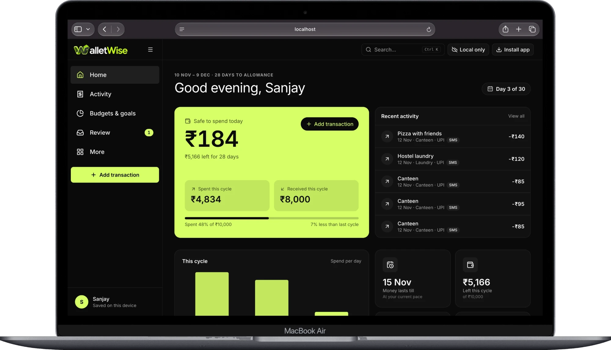
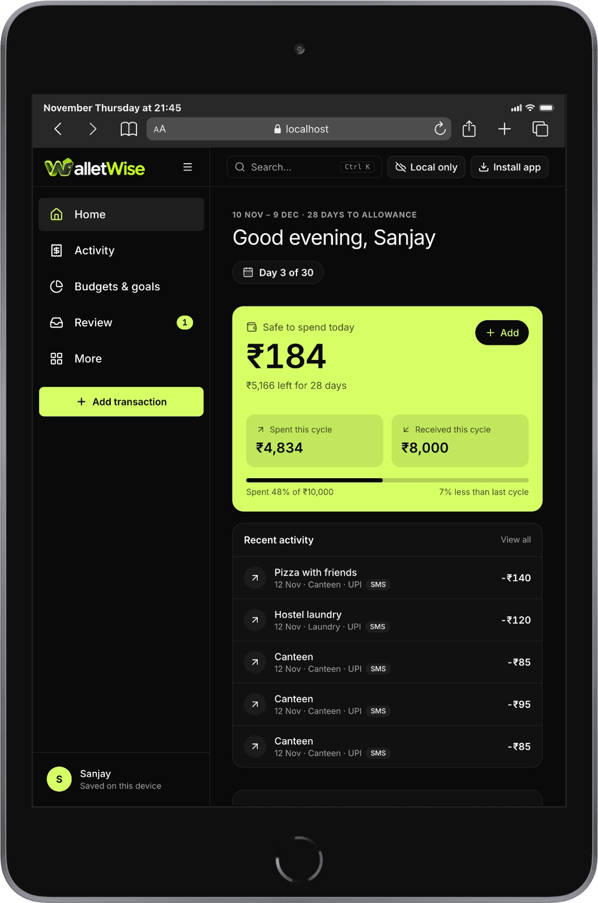
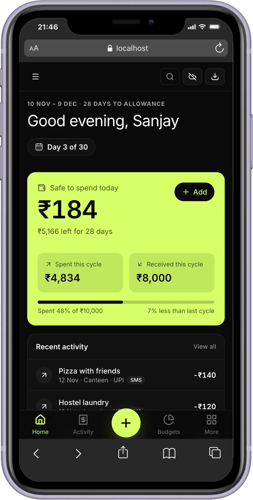
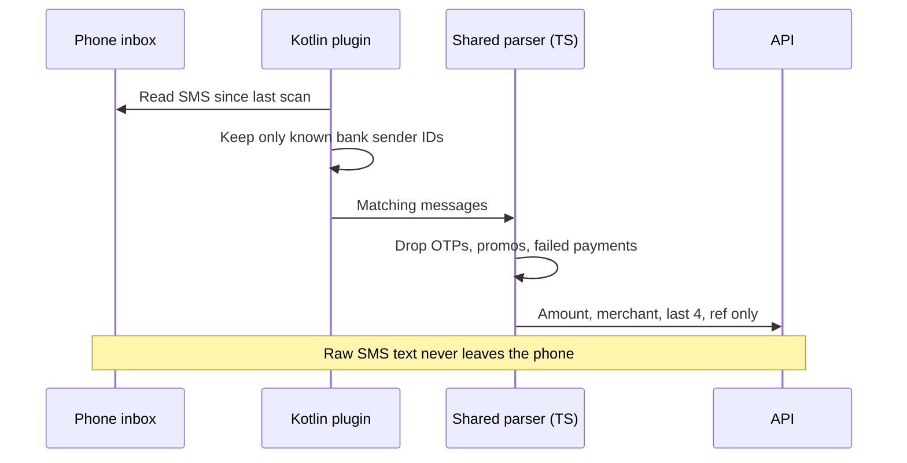
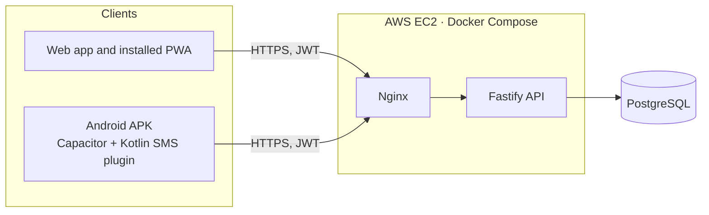

<p align="center">
  
</p>

<h1 align="center">WalletWise</h1>

<p align="center"><b>Know what you can spend today.</b></p>

<p align="center">
  A personal finance app for hostel students. It tracks your spending, keeps you inside a budget, and gives you one number each morning: what is safe to spend.
</p>

<p align="center">
  
</p>

<p align="center">
  
  &nbsp;&nbsp;&nbsp;
  
</p>

Built by **Team G, Microsoft Innovations Club, VIT Chennai**.

## The problem

Hostel students live on a fixed allowance. The money does not vanish in big purchases. It goes in small daily spends like the canteen, the mess extras, laundry, a recharge, a few printouts. Nobody writes those down, so by the third week the question is "where did it all go?"

Most finance apps are built for salaried adults. They want you to type every entry, they talk about investments and credit cards, and their month starts on the 1st even though an allowance rarely does.

## What WalletWise does about it

- **One number that matters.** The home screen shows what is safe to spend today. It is your budget left, divided by the days left until your next allowance.
- **A cycle that starts when your money does.** You tell the app which day your allowance lands, and every budget and chart follows that day instead of the calendar month.
- **Logging in about ten seconds.** Type an amount, tap a category. The categories are made for hostel life: mess, canteen, laundry, recharge, printouts, travel home.
- **Entries that log themselves on Android.** The app reads your bank SMS on the phone and fills in the transaction. iPhone gets bank email capture instead, because iOS does not let any app read SMS.
- **It asks when it is unsure.** If a message is unclear, or a payment looks like a duplicate, it goes to a review list. Nothing is saved on a guess and nothing is silently dropped.
- **Budgets that warn you early.** Set a limit per category and get one alert at 50, 80 and 100 percent. Savings goals tell you how much to set aside each day.
- **Works offline, then syncs.** Everything is saved on your device first. Sign in and the same wallet follows you to your phone and laptop.
- **Installs like an app.** It is a progressive web app, so you can add it to your iPhone, Mac, Android phone or PC and open it from the home screen or dock.

## Screens

| Screen | What it is for |
|---|---|
| Home | Safe to spend today, budget used, when the money runs out, spending by category and per day |
| Activity | Every transaction, with search, filters and a table on wide screens |
| Budgets and goals | Limits per category and the overall cycle budget, plus savings goals with a daily amount |
| Review | Captures the app was unsure about, waiting for you to confirm or reject |
| More | Account and sync, allowance and cycle, CSV export, install help, delete account |

## Platforms

| Capability | Web and laptop | iPhone | Android |
|---|---|---|---|
| Manual entry, budgets, goals, dashboard | Yes | Yes | Yes |
| Install as an app | Yes | Add to Home Screen | Yes |
| SMS capture | No | No | Yes (APK) |
| Bank email capture | Planned | Planned | Planned |
| Bill scan | Planned | Planned | Planned |
| Offline entry | Yes | Yes | Yes |
| Push notifications | Planned | After Add to Home Screen | Planned |

## How SMS capture stays private

Reading SMS is sensitive, so the app is built around not needing your raw messages at all.



The API accepts parsed fields only. Its schema has no place to put a message body, so there is nothing to store even by accident.

## How sync works

Every record gets an id made on the device, so sending the same thing twice can never create a second copy. Changes made offline wait in IndexedDB. When the app is online it pushes them, then pulls everything newer than its cursor, deletions included. If two devices edit the same entry, the server's version number decides the winner, never a phone clock. A payment with the same bank reference number is treated as the same payment. A close match without a reference is kept and flagged for you to review.

## Architecture



The web app and the Android app are the same React code. The API is its own service, so both clients talk to it the same way. The AWS setup is the target and is not deployed yet.

## Tech stack

| Layer | Choice |
|---|---|
| Web app | React 19, Vite, TypeScript, Tailwind CSS 4 |
| Components | The workspace design system (Base UI primitives, shadcn style), Inter, Lucide icons, Recharts |
| Offline data | IndexedDB through Dexie |
| PWA | vite-plugin-pwa (Workbox) |
| Android | Capacitor and a Kotlin SMS plugin |
| API | Fastify 5, Zod validation on every input |
| Database | PostgreSQL with Prisma 6 |
| Auth | Argon2id passwords, 15 minute JWTs, rotating refresh tokens with reuse detection |
| Shared code | `packages/shared`: schemas, API contract, SMS parser, duplicate rules, budget cycle maths |
| Tests | Vitest. The API tests run against a real PostgreSQL database |
| CI | GitHub Actions: lint, typecheck, tests, build, APK build |

## Repository layout

```
apps/
  api/        Fastify API, Prisma schema and migrations
  web/        React app, landing site and dashboard
  android/    Capacitor project and the Kotlin SMS plugin
packages/
  shared/     Contract, parser, dedupe and cycle maths used by every app
infra/        Docker Compose and Nginx config
docs/         Team plan PDF, logo and screenshots
```

## Getting started

You need Node 22, pnpm 10 and a PostgreSQL database. For the APK you also need JDK 21 and the Android SDK.

```bash
pnpm install
cp apps/api/.env.example apps/api/.env
cp apps/web/.env.example apps/web/.env
docker compose -f infra/docker-compose.yml up -d
pnpm --filter @money-tracker/api db:migrate
pnpm --filter @money-tracker/api db:seed
pnpm dev:api     # http://localhost:4000
pnpm dev:web     # http://localhost:5173
```

No Docker? Install PostgreSQL another way (Homebrew works), create a `money` user and a `money_tracker` database, and keep `DATABASE_URL` in `apps/api/.env` pointing at it.

The web app works on its own with data on the device. Sign in from the More screen to sync with the API.

Useful commands:

```bash
pnpm test        # all tests
pnpm typecheck
pnpm lint
pnpm build
```

The API integration tests need a throwaway database. Set `TEST_DATABASE_URL` in `apps/api/.env` (see `.env.example`) and they run with the rest. Without it they are skipped.

Build the Android debug APK:

```bash
pnpm --filter @money-tracker/web build
pnpm --filter @money-tracker/android sync
cd apps/android/android && ./gradlew assembleDebug
```

## Security

- Passwords are hashed with Argon2id. Login takes the same time whether or not the email exists.
- Access tokens last 15 minutes. Refresh tokens are stored hashed and rotated on every use. Using an old one ends every session for that user.
- Every request body is validated with Zod, with length caps on every text field and a 100 KB body limit. There are security headers, a strict CORS allowlist and rate limits, tighter on auth routes.
- Every query is scoped to the signed in user. Someone else's id looks the same as a missing one.
- Money is stored as whole paise, never floats.
- Raw SMS text stays on the phone. Email bodies are not stored.
- Secrets live in environment variables or AWS SSM, never in git.
- Deleting an account removes all of its data and needs the password again.

## Status

Working today:

- The landing site with Home, Features and Compare pages, and a real install flow for iPhone, Mac, Android and PC
- The dashboard on laptop and phone: onboarding, Home, Activity, Budgets and goals, Review, More
- Local first storage and the budget cycle maths
- The API: accounts, categories, transactions with search and edit, budgets, goals, sync, insights, SMS rules and ingestion, review list, push registration, CSV export, account deletion
- Sync between the app and the API, with conflict handling and duplicate detection
- Tests: 21 shared, 43 API on a real database, 19 for the sync client

Not built yet:

- The background worker for budget alerts and recurring entries, and sending push notifications
- The live Android SMS listener, release signing and device testing
- Bank email capture and bill scanning
- Terraform, the deploy pipeline and anything running on AWS
- A published Android APK

The full plan, decisions and test cases are in [`docs/money-tracker-team-plan.pdf`](docs/money-tracker-team-plan.pdf).

## Team

Built by **Undercut Engineers**, Team G of the Microsoft Innovations Club, VIT Chennai.

<table>
  <tr>
    <td align="center" width="33%">
      <br />
      <b>Prodhosh VS</b><br />
      Team leader
    </td>
    <td align="center" width="33%">
      <br />
      <b>Ashvin K S</b><br />
      Senior member
    </td>
    <td align="center" width="33%">
      <br />
      <b>Harsh Sharma</b><br />
      Senior member
    </td>
  </tr>
  <tr>
    <td align="center" width="33%">
      <br />
      <b>Souptik Dam</b><br />
      Senior member
    </td>
    <td align="center" width="33%">
      <br />
      <b>Yashwant Gokul P</b><br />
      Junior member
    </td>
    <td align="center" width="33%">
      <br />
      <b>Yojit Arora</b><br />
      Junior member
    </td>
  </tr>
</table>
